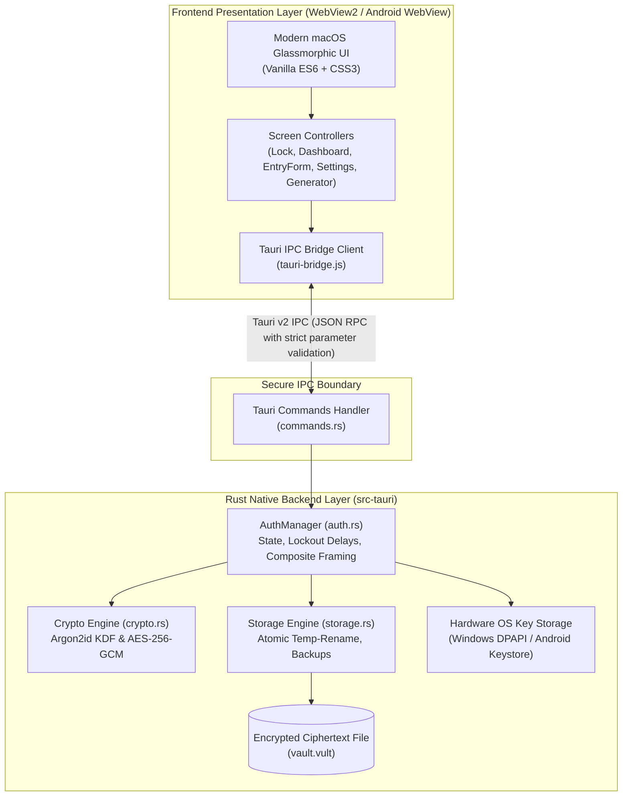
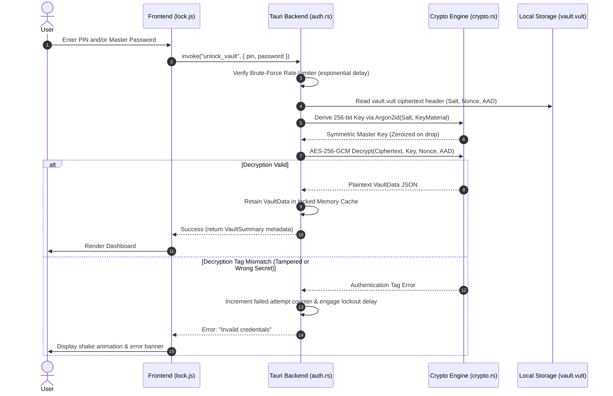
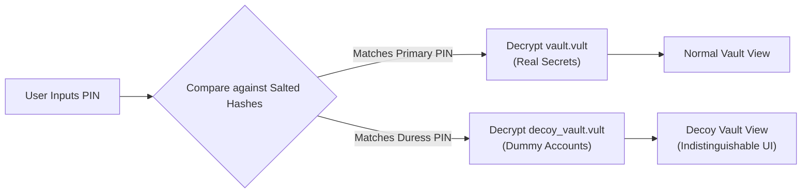

# System Architecture Specification — Vult

**Product**: Vult Architecture (Desktop & Mobile)  
**Version**: 1.0.0 Stable Baseline $\rightarrow$ 2.0.0 Evolutionary Design  
**Author**: Kurados  

---

## 1. High-Level Architectural Overview

Vult is constructed on a **Local-First, Dual-Layer Architecture** combining a secure, memory-safe systems programming language (**Rust**) for cryptography and OS integration with an ultra-lightweight, hardware-accelerated **Web Frontend** (Vanilla ES6 modules + CSS3) rendered via native system web engines (WebView2 on Windows, Android System WebView on Android).



---

## 2. Directory & Module Structure

```
vult/
├── src/                               # Frontend Presentation Layer
│   ├── index.html                     # Single-Page Application Host
│   ├── assets/                        # Static Branding & Icons (logo.png)
│   ├── styles/                        # Modular Glassmorphic Design System
│   │   ├── main.css                   # Global variables, typography, modals
│   │   ├── lock-screen.css            # Lock, PIN pad, & Onboarding styles
│   │   ├── dashboard.css              # Dashboard, category filters, cards
│   │   ├── entry-form.css             # Dynamic multi-category input forms
│   │   ├── entry-detail.css           # View secrets, one-click copy, tags
│   │   └── settings.css               # Security controls, backup, about box
│   └── js/                            # Modular ES6 Logic
│       ├── app.js                     # Root lifecycle router & lock timer
│       ├── components/                # Reusable UI widgets
│       │   ├── modal.js               # macOS dark modals (PIN, Password, Confirm)
│       │   └── toast.js               # Non-blocking HUD toast notifications
│       ├── screens/                   # Route screens
│       │   ├── lock.js                # PIN keypad & password unlock
│       │   ├── dashboard.js           # Vault summary, search, category pills
│       │   ├── entry-form.js          # Secret creation/edit & auto-detection
│       │   ├── entry-detail.js        # Secret inspection & clipboard triggers
│       │   ├── generator.js           # Web-safe password generator
│       │   └── settings.js            # Auth mode, biometric, exports
│       └── utils/                     # Helpers & IPC abstraction
│           ├── code-detector.js       # 12+ recovery code regex engine
│           ├── helpers.js             # Password entropy & date formatters
│           └── tauri-bridge.js        # Type-safe wrapper for Tauri invoke
│
├── src-tauri/                         # Rust Native Systems Layer
│   ├── Cargo.toml                     # Dependencies (AES-GCM, Argon2, RFD, DPAPI)
│   ├── tauri.conf.json                # Window constraints (400x620), CSP, bundle
│   └── src/
│       ├── lib.rs                     # Tauri plugin init & command registry
│       ├── main.rs                    # Application entrypoint
│       ├── commands.rs                # IPC endpoint dispatchers
│       ├── auth.rs                    # AuthManager, session lock, lockout
│       ├── crypto.rs                  # Argon2id, AES-256-GCM, Zeroize
│       ├── storage.rs                 # Atomic filesystem read/write
│       └── models.rs                  # Strongly-typed Serde data models
│
└── docs/                              # Formal Architectural Documentation
    ├── PRD.md                         # Product Requirements Document
    ├── ARCHITECTURE.md                # System Architecture & Diagrams (this file)
    ├── RULES.md                       # Security & Development Guidelines
    ├── DESIGN.md                      # Design System & UI Specifications
    ├── TASKS.md                       # Roadmap & Implementation Plan
    └── MEMORY.md                      # Audit Trail, Decisions, & Bug Log
```

---

## 3. Cryptographic Architecture & Data Flow

Vult guarantees that unencrypted plaintext secrets **never** touch disk and reside in RAM only while the vault is explicitly unlocked.



### 3.1 Authenticated Encryption (AEAD) Framing
Every `.vult` encrypted archive is binary-framed to prevent ciphertext truncation, bit-flipping, or padding oracle attacks:

$$\text{Vault Payload} = \text{Magic} \,(4\text{B}) \parallel \text{Version} \,(2\text{B}) \parallel \text{Argon2 Params} \,(16\text{B}) \parallel \text{Salt} \,(32\text{B}) \parallel \text{Nonce} \,(12\text{B}) \parallel \text{Ciphertext} \parallel \text{Tag} \,(16\text{B})$$

- **Magic**: `0x56 0x55 0x4C 0x54` (`VULT`)
- **Version**: Format version (e.g., `0x00 0x02` for V2)
- **AAD (Additional Authenticated Data)**: The unencrypted header (Magic + Version + Params) is passed directly as AAD into AES-256-GCM. Any modification of the header causes decryption to fail immediately before parsing.

### 3.2 Key Material Composition (Composite Key Framing)
To completely prevent collision attacks between PIN-only, Password-only, and PIN+Password modes, input secrets are framed with unambiguous length-prefixed framing before hashing:

$$\text{KeyMaterial} = \text{SHA-256}(\text{len}(\text{PIN}) \parallel \text{PIN} \parallel \text{len}(\text{Password}) \parallel \text{Password})$$

---

## 4. Hardware Security & OS Credential Binding

### 4.1 Windows Desktop (DPAPI & Windows Hello)
- When the user enables "Windows Hello Unlock", Vult derives a random 256-bit biometric vault unlock token.
- This token is encrypted using the Windows Data Protection API (`CryptProtectData`) with machine- and user-bound entropy.
- When unlocking, `CryptUnprotectData` is executed inside the Rust backend after the user verifies their fingerprint, PIN, or facial recognition via Windows Hello.

### 4.2 Android Mobile (Android Keystore & BiometricPrompt)
- On Android, the biometric token is stored in the **Android Keystore System** backed by the hardware Secure Element (SE) / StrongBox Keymaster.
- Keys require user authentication: `KeyGenParameterSpec.Builder.setUserAuthenticationRequired(true)`.
- Biometric verification uses Android's native `BiometricPrompt` API.

---

## 5. Version 2.0.0 Architecture Extensions

### 5.1 Duress Vault Engine (Plausible Deniability)

- The disk maintains two separate AES-256-GCM files: `vault.vult` and `decoy_vault.vult`.
- Decryption of `decoy_vault.vult` leaves the primary vault unopened, completely unmapped in RAM.

### 5.2 Ghost Typing Subsystem
- Interacts with OS input hooks (`SendInput` on Windows, Accessibility Service on Android) to emit keyboard scancodes into whatever third-party window has focus.
- Plaintext never enters the OS clipboard, rendering clipboard snooper malware ineffective.

### 5.3 Local LAN P2P Zero-Cloud Sync
- **Discovery**: Zero-configuration local network discovery via mDNS / DNS-SD (`_vult-sync._tcp.local`).
- **Mutual Authentication**: Devices exchange ephemeral public keys via QR code scan (Out-Of-Band pairing).
- **Transport**: Direct peer-to-peer TLS connection over local Wi-Fi.
- **Synchronization**: CRDT (Conflict-Free Replicated Data Type) or encrypted delta changeset merge. No external server ever receives data.
